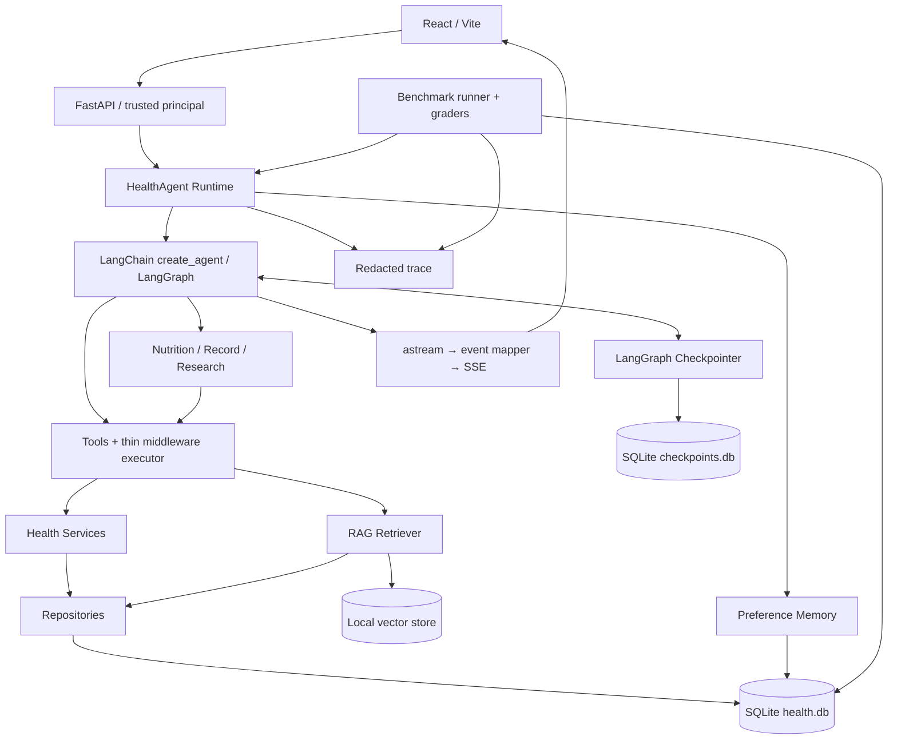

# HealthAgent 独立架构方案

状态：目前工程交付到 Phase 12，含 29 个合成任务的 Benchmark 和离线基线/优化/复跑闭环；真实 provider 当前连接失败，在线能力验收仍待服务恢复。**下文完整目录中尚未落地的完整 Skills 系统仍属目标设计。** 当前落地以各阶段交付记录及 [README](../README.md) 为准。来源约束为 [HEALTH_AGENT_SPEC.md](../HEALTH_AGENT_SPEC.md)，DeerFlow 取舍依据见 [源码分析](phase-0-deerflow-analysis.md) 与 [UI 参考](ui-deerflow-reference.md)。

当前落地选择：健康数据 / Thread metadata / Memory / 文档片段与向量统一使用 SQLAlchemy 管理的 health.db；脱敏 Trace 使用同一数据库的独立 execution_traces 表。官方 AsyncSqliteSaver 独立使用 checkpoints.db。Lead create_agent 注册九个健康 / RAG 工具，另有可关闭的专业委派工具；三个子图使用白名单只读工具、无递归委派与 checkpoint。框架 middleware 配合可信共享预算管理重试、超时、调用上限和偏好注入。RAG 默认 1024 维词面 n-gram embedding，支持显式切换 provider；scope 在 SQL 中先过滤。Memory 只提取明确枚举偏好，通过临时 HumanMessage 注入。SSE 同时服务 Python 客户端和独立 React / Vite 工作台，当前只支持单 worker。

本次 UI 选择 React / Vite 静态构建以减少部署层次；FastAPI 提供 / 与 /assets，开发环境使用 Vite 同源代理，导航使用 hash。API 请求依旧经过服务端身份和既有 Service / Repository。Thread 元数据补充真实首条问题标题、状态和 can_resume；浏览器以 can_resume 判断恢复资格，不能用 checkpoint pending 单独判断。

Trace 通过公开 LangChain callbacks 记录模型 / 工具物理尝试，领域 hooks 记录委派、工具重试与 guardrail。总步骤是 model_calls + tool_calls，不是 LangGraph super-step。摘要与事件只含白名单元数据；SDK 隐藏重试、缺失 token usage 和进程中断未写入的事件均明确标记不可观测。存储开始失败拒绝执行，终态存储失败不能返回已审计成功；业务提交与 checkpoint 保留，后续原请求恢复。

Phase 12 的 Trace 完整性要求 started 与 ended 的实际 run_id 集合相等；无调用的缓存回放仍可完整，缺失 timeout/cancel 回调的调用明确标记 incomplete。未观察到的结束事件不会由评分器或报告猜测补齐。

local_hash 检索在既有 SQL owner/visibility 范围内增加原始词法特征交集检查，避免哈希桶碰撞使无共同词项的文本得出非零相似度。词法函数与向量计算共享 NFKC/lower/词与二元特征规则，原向量和索引版本保持兼容；provider 语义 embedding 不加该门控。此修复不解决有少量共同词但主题不相关的误召回。

## 1. 架构决策

后端采用单个 Python 应用包、FastAPI、Pydantic 和 LangChain `create_agent`；其底层使用 LangGraph。Phase 1 不额外套一层空 StateGraph。未来确有固定审批 / 分析流程时，再使用 StateGraph 表达业务节点。

存储首版采用 SQLite：业务数据由 SQLAlchemy 管理，图状态由官方 AsyncSqliteSaver 管理。二者在不同文件中，避免应用迁移误改框架表。Web 当前采用 React / Vite + TypeScript，实现本项目的 Chat、Thread、Documents、Health Records、Memory 管理与 Trace 查看。



图中并非每次请求都经过 RAG / Memory / SubAgent。简单记录查询保持 Lead → Tool → Service → Repository 路径。

## 2. 最终目标目录

下面是按规范调整后的完整目标结构。当前实际目录随 Phase 0–10 实现有所合并；例如小规模向量存储直接复用 persistence，三个专业角色共用 agents/subagents.py，可靠性集中在 agent/reliability.py，Trace 位于 observability/。未因示例目录而创建空壳模块；Benchmark 将在 Phase 11 开始。

```text
HealthAgent/
├── AGENTS.md
├── HEALTH_AGENT_SPEC.md
├── README.md
├── .gitignore
├── .env.example                         # Phase 1，无真实密钥
├── backend/
│   ├── pyproject.toml                    # Phase 1 独立 Python 项目
│   ├── uv.lock
│   ├── app/
│   │   ├── __init__.py
│   │   ├── main.py                      # FastAPI factory / lifespan
│   │   ├── config.py                    # 唯一配置入口
│   │   ├── dependencies.py              # 模型、runtime、服务注入
│   │   ├── api/
│   │   │   ├── chat.py                  # 非流式 / SSE 聊天
│   │   │   ├── threads.py
│   │   │   ├── documents.py
│   │   │   ├── health.py
│   │   │   ├── memory.py                # 偏好查看、纠正与删除
│   │   │   └── schemas.py               # HTTP DTO 与错误契约
│   │   ├── auth/
│   │   │   └── principal.py             # 可信身份解析，独立于模型
│   │   ├── models/
│   │   │   └── factory.py               # BaseChatModel factory
│   │   ├── agent/
│   │   │   ├── runtime.py               # invoke / stream / 运行预算
│   │   │   ├── context.py               # RunContext，非模型可写参数
│   │   │   ├── state.py                 # 必要时扩展 AgentState
│   │   │   ├── events.py                # 与 UI 解耦的领域事件
│   │   │   └── errors.py                # 统一异常到 API / trace
│   │   ├── agents/
│   │   │   ├── lead_agent.py
│   │   │   ├── prompts.py
│   │   │   ├── nutrition_agent.py
│   │   │   ├── record_agent.py
│   │   │   └── research_agent.py
│   │   ├── tools/
│   │   │   ├── registry.py
│   │   │   ├── executor.py              # middleware 薄适配，无自写循环
│   │   │   ├── result.py
│   │   │   └── health/
│   │   │       ├── metrics.py
│   │   │       ├── diet.py
│   │   │       ├── exercise.py
│   │   │       ├── documents.py
│   │   │       └── knowledge.py
│   │   ├── health/
│   │   │   ├── models.py                # 首版五种核心 ORM 模型
│   │   │   ├── schemas.py               # 业务校验；大后再拆包
│   │   │   ├── services/
│   │   │   │   ├── metrics.py
│   │   │   │   ├── diet.py
│   │   │   │   ├── exercise.py
│   │   │   │   └── documents.py
│   │   │   └── repositories/
│   │   │       ├── profiles.py
│   │   │       ├── metrics.py
│   │   │       ├── diet.py
│   │   │       ├── exercise.py
│   │   │       └── documents.py
│   │   ├── persistence/
│   │   │   ├── database.py              # SQLAlchemy engine/session
│   │   │   ├── checkpointer.py          # 官方 saver 生命周期
│   │   │   ├── threads.py               # metadata / owner lookup
│   │   │   └── migrations/
│   │   ├── rag/
│   │   │   ├── ingestion.py
│   │   │   ├── splitter.py
│   │   │   ├── embeddings.py
│   │   │   ├── vector_store.py          # 使用现有集成，不自研向量引擎
│   │   │   └── retriever.py
│   │   ├── memory/
│   │   │   ├── store.py
│   │   │   ├── extractor.py
│   │   │   ├── retriever.py
│   │   │   └── middleware.py
│   │   ├── skills/
│   │   │   ├── loader.py
│   │   │   └── workflows/              # 五种领域工作流 Markdown
│   │   ├── streaming/
│   │   │   └── sse.py
│   │   ├── guardrails/
│   │   │   ├── safety.py
│   │   │   └── loop.py
│   │   └── tracing/
│   │       ├── events.py
│   │       └── recorder.py
│   └── tests/
│       ├── conftest.py
│       ├── fakes.py
│       ├── unit/
│       ├── integration/
│       └── live/                        # 显式开启，默认不调用外部模型
├── frontend/
│   ├── package.json
│   ├── src/
│   │   ├── app/                        # Chat / Documents / Records 页面
│   │   ├── components/                 # 消息、工具步骤、记录表单等
│   │   └── lib/                        # API、SSE decoder、类型
│   └── tests/
├── benchmark/
│   ├── cases/                          # 初版 20–30 个合成环境用例
│   ├── graders/
│   ├── runner.py
│   ├── report.py
│   └── runs/                           # 本地原始输出，gitignored
├── data/                               # gitignored
│   ├── health.db
│   ├── checkpoints.db
│   ├── uploads/
│   ├── vectors/
│   └── traces/
└── docs/                               # 架构、阶段交付、评测汇总
```

相较规范示例：配置统一为 `app/config.py`，避免重复配置；五个 ORM 模型先放一个文件；明确增加可信身份、数据库生命周期、持久会话、测试 fake 和 API DTO 的位置。保持单包结构，暂不拆 harness。

## 3. 状态、身份与持久化边界

| 对象 | 内容 | 权限及生命周期 |
| --- | --- | --- |
| RunContext | 服务端确定的 user_id、timezone、trace_id、run_id、服务依赖 | 作为 `context=` 注入；不接受模型覆盖，不把连接或密钥放进 checkpoint |
| AgentState | messages；后续需要的步骤计数、证据引用、停止原因 | 框架 reducer 管理；避免复制业务记录全集 |
| Thread | thread_id、user_id、metadata、created_at / updated_at | 每次读写 / 执行 / 恢复前检查 owner |
| Checkpoint | 框架执行状态 | LangGraph saver 负责；thread_id 本身不是权限凭证 |
| Health DB | 结构化事实 | Repository 的所有查询、更新和删除都带可信 user_id |
| Memory | 偏好、表达风格、稳定目标 | 按用户隔离；可查看、纠正、删除；不代替事实库 |
| Trace | 事件、耗时、调用计数、错误与停止原因 | 按用户 / thread / run 关联，默认仅脱敏摘要 |

Phase 1 可以采用仅 loopback 的单用户开发配置，其 identity 由服务端固定。该模式不是多用户鉴权。开始存储健康数据时至少实现服务端凭据到用户的解析及跨用户负例测试；公共部署前必须启用真实鉴权，不能信任任意 `X-User-ID` 或请求体 `user_id`。

时间输入保留时区，持久化规范化为 UTC；“今天”按用户 timezone 解析。体重、心率、睡眠、步数校验单位和合理的格式范围；缺字段或语义不清时澄清，不推测成已确认事实。

## 4. 最小业务模型与工具契约

| 模型 | 首版字段与规则 |
| --- | --- |
| UserProfile | user_id、age、height、created_at；年龄 / 身高按业务需要可空，不强制收集额外敏感字段 |
| HealthMetric | id、user_id、metric_type、value、unit、measured_at |
| DietRecord | id、user_id、food_name、amount、meal_type、timestamp、nutrition_info；额外 amount_unit 防止数量歧义，未知营养信息不编造 |
| ExerciseRecord | id、user_id、exercise_type、duration、distance、calories、timestamp；时长 / 距离单位固定并公开，未知字段可空 |
| HealthDocument | id、user_id、filename、document_type、created_at、parse_status、index_status；关联内部 storage key / content hash |

九个首版工具：query_health_metrics、add_health_metric、query_diet_records、add_diet_record、query_exercise_records、add_exercise_record、query_health_documents、search_health_knowledge、calculate_health_trend。

统一返回：`success`、`data`、`error_code`、`error_message`、`retryable`。例如空查询是 `success=true, data=[]`，并非系统错误；趋势样本不足返回可识别的 `INSUFFICIENT_DATA`，不进行相同参数网络重试。模型据此改查原始记录或说明不足。

写入在事务提交后才返回成功和 record id。幂等键由服务端动作身份生成并在数据库唯一约束中执行；提交结果不明时先查已有结果，不盲目重复写入。首次九个工具不包含删除 / 覆盖，未来增加时再接确认流程与 `interrupt` / `Command(resume=...)`，确认绑定用户、记录、版本及操作内容。

## 5. RAG 与 Memory

RAG 分为 public 和 personal 两个数据域：导入 → 解析 → chunk → embedding → 本地持久向量存储 → retrieval → 带证据回答。Phase 5 再选择并锁定经中文样本验证的 LangChain 向量库集成和 embedding 模型；模型首次下载与离线缓存需求需写入 README，不能声称从未准备的机器可完全离线运行。

personal 检索必须在召回前应用可信 user_id 过滤，返回后再核对 document owner；public 文档只能由管理导入流程设为 public，用户上传不能自行改变可见性。chunk 保存 document_id、chunk_id、页码 / 段落、来源与索引版本。检索内容是不可信数据，不能发出工具指令。

初版优先 TXT / Markdown 与可提取文本的 PDF；扫描件未支持 OCR 时标为解析失败 / 需处理，不谎称已入库。索引与数据库状态分开：未完成索引的文档不参与检索；失败记录保留可重试状态。无证据时直接说明，不生成虚构医学链接。

Memory 以少量允许的偏好类型提取，保留来源时间和 source message id。客观健康记录经 Tool 落库，不能仅由 Memory extractor 写入偏好文本。每次运行按用户读取相关偏好，作为数据注入；提取失败不得导致已经成功写入的健康记录被回滚或重复提交。

## 6. 可靠性与流事件

三个独立限制：`max_steps` 映射到 LangGraph recursion_limit 的 super-step 预算；`max_tool_calls` 用框架调用限制 middleware；总运行 timeout 覆盖模型与工具等待。它们不是同一个计数，不将 recursion_limit 宣称为精确模型调用次数。

优先使用框架有限工具重试，外层将最终异常转换成统一 ToolResult。**不能先吞掉异常，再期望框架重试看到它。** 只允许经过分类的 timeout / 429 / 可恢复 5xx / 连接错误；写工具必须先满足幂等条件。模型 SDK 重试、工具重试和 re-plan 各有独立上限，避免相乘造成隐藏重试风暴。保留 cancellation 和图 interrupt，不转成普通工具失败。

重复检测使用“工具名 + 规范化参数 + 无进展 / 相同结果摘要”，达到阈值后一次受限 re-plan，仍无进展则终止。不给等待中的实时指标、合法分批分页等调用误加无限恢复循环。

SSE 目标协议为 `run.started`、`message.delta`、`tool.started`、`tool.finished`、`run.completed`、`run.failed`；按需增加 `subagent.*`。统一载荷含 version、run_id、thread_id、seq、type、data。最终文本以 completed 的最终消息为准，避免 delta 与最终消息重复拼接。

浏览器使用 POST fetch + ReadableStream，支持跨网络 chunk 的帧拼接、UTF-8 分片、空行边界和取消；原生 EventSource 不能直接完成此 POST 契约。API 和 runtime 的流对象在 finally 中关闭，输出不包含隐藏推理、密钥或完整私有 state。Phase 4 先验证单连接，Phase 9 再构建完整 UI。

## 7. 测试与真实评测

单元测试覆盖 Repository owner 过滤、Service 单位与日期校验、ToolResult、有限重试、Memory 提取。集成测试通过真实 LangGraph 图和临时 SQLite 验证 Agent → Tool → DB，以及 Agent → RAG → Retriever。fake 模型只固定决策以测试运行链路，不能用于宣称自然语言理解效果。

Phase 11 的 20–30 个用例覆盖规范第 22 节的 12 类任务。用例含 case_id、input、initial_environment、expected_state、expected_tool、forbidden_tool、expected_answer_constraints、grader，并用隔离的合成用户与临时数据库重置环境。

| 指标 | 判定与统计口径 |
| --- | --- |
| Task Success Rate | DB / ground truth / evidence / 必要步骤全部满足的用例占比 |
| Tool Selection / Argument Accuracy | 对需要工具的可判定用例，比较期望工具及标准化参数；说明分母 |
| Tool Execution Success Rate | 单次实际工具尝试的成功占比，单独保留重试次数 |
| Recovery Rate | 注入可恢复失败的用例最终成功占比 |
| Loop Rate | 被重复检测 / 步数预算识别的循环用例占比，区分正常预算耗尽 |
| Average Calls / Steps / Latency | 每个用例的真实 trace 计算；失败也计入，不只展示成功样本 |
| Retrieval Hit / Grounded Answer | 对 RAG 用例比较目标 evidence id 和引用事实；缺证据不算通过 |

无适用用例或缺少 usage 字段时报告 N/A / null，不以 0 代替。分类至少覆盖 Tool Selection Error、Tool Argument Error、Tool Runtime Error、RAG Retrieval Error、Reasoning Error、SubAgent Routing Error、Loop、Early Stop、Safety Violation。

Phase 12 用同一版本数据集、模型配置、prompt、随机种子和环境重新评测。先留存 baseline，再根据 trace 定位失败、优化、复跑，报告真实差异和重复运行波动。

当前实现位于 `benchmark/`：schema 校验29个案例，environment 经真实 Service 装载种子，runner 通过实际 API 执行，observation 获取 SQL 快照/ToolResult/持久 Trace 并核验 citation，grader 独立判分，report 输出统计及拒绝不可比较的实验。contract 模型仅接收 execution_plan，真实 provider 不接收期望答案。每案例使用独立临时数据库并关闭外部 tracing。

工具选择按必需/禁止断言、参数按实际模型提议次数统计；contract 模式两项为 N/A。工具执行成功率只覆盖观测到 finished 的尝试，另报 finished/started 完整率。平均调用/步骤只计算完整 Trace，并公开样本量；延迟分别给出含准备时间的案例耗时和 Trace 执行耗时。源代码、评分器、案例、运行协议和配置以 SHA-256 记录，compare 检查除了 app 源码外的协议要素不变。精确运行命令和限制见 [Benchmark 操作说明](../benchmark/README.md)。

## 8. 阶段落点

| 阶段 | 交付边界 | 验收重点 |
| --- | --- | --- |
| 0 | 当前文档 | 真实路径、完整调用链、设计与可执行计划 |
| 1 | 工程 + FastAPI + 最小 Lead | fake 离线链路；真实模型测试另列 |
| 2 | 九个工具与健康业务层 | 真实 DB 断言、参数与用户隔离 |
| 3 | Thread / AsyncSqliteSaver | 续聊、重启恢复、owner 负例 |
| 4 | LangGraph → SSE → 测试客户端 | 流序列、完成、异常、断线取消 |
| 5 | 两域 RAG | 入库 / 索引 / 引用 / personal 隔离 |
| 6 | 偏好 Memory | 提取、持久化、检索注入与事实分离 |
| 7 | 三类 SubAgent；有收益时加 Skill | 路由、上下文隔离、结果聚合 |
| 8 | 完整 reliability / guardrail | 故障注入、循环、写操作幂等；身份与基本安全从早期就执行 |
| 9 | Web UI | Chat / Thread / Streaming / Documents / Health Records |
| 10 | 完整 Trace | 可定位失败；早期已有基本 trace_id 与错误日志 |
| 11 | 20–30 case Benchmark | 真实环境判分和指标报告 |
| 12 | Baseline → 优化 → 复跑 | 可复现的失败分析，不伪造提升 |
