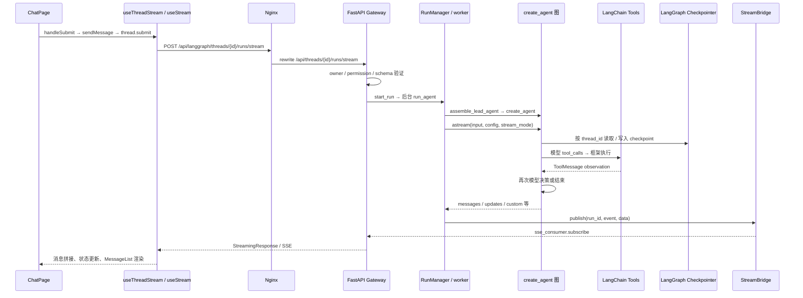

# Phase 0 — DeerFlow Reference Analysis

调研日期：2026-10-03（Asia/Shanghai）。参考根目录：`D:\AgentFiles\deer-flow`。本报告是静态源码分析，不代表已启动或执行 DeerFlow。

## 1. 范围与证据

已读取用户给定规范、DeerFlow README、目录指南及下列核心源码。首次任务遵守规范第 32 节，只完成研究、设计与下一阶段计划。

本地 `deer-flow` 和父目录均不在 Git 工作树内；`git status --short`、`git diff --stat` 和 `git rev-parse HEAD` 无法提供版本信息。用 [源码快照](reference-snapshot.json) 标记参考文件内容；其中 SHA-256 不是 Git commit。未修改 DeerFlow 源码。

源码声明与 lockfile 观察值如下，**不是 HealthAgent 依赖清单，也不是环境中已安装版本**：

| 来源 | 观察值 |
| --- | --- |
| [backend/pyproject.toml](../../deer-flow/backend/pyproject.toml) | 应用名 `deer-flow`，版本 `2.2.0-dev`，Python ≥ 3.12 |
| [harness/pyproject.toml](../../deer-flow/backend/packages/harness/pyproject.toml) | `deerflow-harness`，版本 `2.1.0`；依赖 LangChain ≥ 1.3、LangGraph ≥ 1.2.9 且 < 1.3 |
| [backend/uv.lock](../../deer-flow/backend/uv.lock) | LangChain 1.3.14、langchain-core 1.4.9、LangGraph 1.2.9、checkpoint 4.2.0、checkpoint-sqlite 3.1.1 |
| [frontend/package.json](../../deer-flow/frontend/package.json) | Next.js `^16.3.3`、React `^19.0.0`、LangGraph SDK `^1.5.3` |

源码版本声明存在不同包的独立值，本报告只记录事实，不替参考项目修订版本。

## 2. 当前真实目录与源码索引

当前后端是 `backend/app` 与 `backend/packages/harness/deerflow` 分层，不能套用旧版本 `backend/src` 等路径。下列行号对应本地调研快照；源码链接打开文件，符号与行号用于定位。

| 模块 | 真实文件与定位 | 职责 / 框架接点 |
| --- | --- | --- |
| Lead factory | [agents/lead_agent/agent.py](../../deer-flow/backend/packages/harness/deerflow/agents/lead_agent/agent.py)，`make_lead_agent` L810、`assemble_lead_agent` L815、`create_agent` L1274 | 组合模型、权限过滤后的工具、prompt、middleware、state schema，返回图及装配描述 |
| Prompt | [agents/lead_agent/prompt.py](../../deer-flow/backend/packages/harness/deerflow/agents/lead_agent/prompt.py)，`_get_memory_context` L708、`apply_prompt_template` L1011 | 静态规则、技能目录、委派说明；Memory 正文由动态上下文中间件读取 |
| 模型 | [models/factory.py](../../deer-flow/backend/packages/harness/deerflow/models/factory.py)，`create_chat_model` L364 | 将配置解析为 LangChain `BaseChatModel`，处理模型选项及 provider 差异 |
| State | [agents/thread_state.py](../../deer-flow/backend/packages/harness/deerflow/agents/thread_state.py)，`ThreadState` L280、`DeltaThreadState` L396 | 继承 `AgentState`，扩展 artifact / goal / skill 等 reducer；可选 DeltaChannel |
| Tool registry | [tools/tools.py](../../deer-flow/backend/packages/harness/deerflow/tools/tools.py)，`get_available_tools` L104 | 聚合配置、内置、MCP、SubAgent 等 `BaseTool`，不是自写 Agent 循环 |
| Tool schema 示例 | [tools/builtins/clarification_tool.py](../../deer-flow/backend/packages/harness/deerflow/tools/builtins/clarification_tool.py) | 使用 `langchain.tools.tool` 定义模型可调用接口 |
| Tool 执行边界 | [middlewares/tool_error_handling_middleware.py](../../deer-flow/backend/packages/harness/deerflow/agents/middlewares/tool_error_handling_middleware.py)，`wrap_tool_call` L161、`awrap_tool_call` L180 | 包裹框架 handler，异常变成带 call id 的 `ToolMessage`；放行 `GraphBubbleUp` |
| 应用启动 | [gateway/app.py](../../deer-flow/backend/app/gateway/app.py)，`lifespan` L396；[gateway/deps.py](../../deer-flow/backend/app/gateway/deps.py)，L454–464、L602 | FastAPI 生命周期拥有 bridge、数据库、checkpointer、store、RunManager |
| Thread API | [routers/threads.py](../../deer-flow/backend/app/gateway/routers/threads.py)，创建 L866、state L1446 | 会话元数据、所有权及图状态查询；这些 REST 接口是应用层能力 |
| Thread 元数据 | [thread_meta/model.py](../../deer-flow/backend/packages/harness/deerflow/persistence/thread_meta/model.py)；[thread_meta/sql.py](../../deer-flow/backend/packages/harness/deerflow/persistence/thread_meta/sql.py)，`get` L166 | SQLAlchemy 保存 user_id、thread_id、status、metadata；查询带 owner 过滤 |
| Run HTTP | [routers/thread_runs.py](../../deer-flow/backend/app/gateway/routers/thread_runs.py)，`stream_run` L965 | 创建 run 并返回 `StreamingResponse`，媒体类型为 `text/event-stream` |
| Run service | [gateway/services.py](../../deer-flow/backend/app/gateway/services.py)，`start_run` L1676、`sse_consumer` L2296、`format_sse` L168 | 参数归一、run 准入、后台执行、订阅流与 SSE 格式化 |
| Run lifecycle | [runtime/runs/manager.py](../../deer-flow/backend/packages/harness/deerflow/runtime/runs/manager.py) | 管理活动 run、冲突、取消、持久记录及恢复，与 LangGraph 图执行分工 |
| Runtime worker | [runtime/runs/worker.py](../../deer-flow/backend/packages/harness/deerflow/runtime/runs/worker.py)，`run_agent` L830、图流 L1294 / L1334 | 构建运行上下文、图、checkpoint、journal，消费 `agent.astream` |
| Checkpointer | [checkpointer/async_provider.py](../../deer-flow/backend/packages/harness/deerflow/runtime/checkpointer/async_provider.py)，`make_checkpointer` L220 | 官方 `InMemorySaver`、`AsyncSqliteSaver`、`AsyncPostgresSaver` 生命周期 |
| State 读取 | [runtime/checkpoint_state.py](../../deer-flow/backend/packages/harness/deerflow/runtime/checkpoint_state.py)，L37、L141 / L147 | `StateGraph` 状态更新图；`get_state` / `aget_state` 等物化状态入口 |
| Stream mode | [runtime/stream_modes.py](../../deer-flow/backend/packages/harness/deerflow/runtime/stream_modes.py) | 公共 `messages-tuple` 映射到框架 `messages`，严格检查模式 |
| Stream transport | [stream_bridge/base.py](../../deer-flow/backend/packages/harness/deerflow/runtime/stream_bridge/base.py)、[memory.py](../../deer-flow/backend/packages/harness/deerflow/runtime/stream_bridge/memory.py)、[redis.py](../../deer-flow/backend/packages/harness/deerflow/runtime/stream_bridge/redis.py) | bridge 抽象与进程内 / 跨进程后端；worker 发布，HTTP 订阅 |
| Memory contract | [agents/memory/manager.py](../../deer-flow/backend/packages/harness/deerflow/agents/memory/manager.py)，`MemoryManager` L121、factory L940 | 可替换 Memory backend，统一读写；不是 LangGraph Checkpointer |
| Memory 写入 | [middlewares/memory_middleware.py](../../deer-flow/backend/packages/harness/deerflow/agents/middlewares/memory_middleware.py)，`after_agent` L194、`aafter_agent` L214 | 结束后携带可信 user_id / trace_id 调用 `add` / `aadd` |
| Memory 注入 | [middlewares/dynamic_context_middleware.py](../../deer-flow/backend/packages/harness/deerflow/agents/middlewares/dynamic_context_middleware.py)，读取 L436、消息构建 L494 起 | `AgentMiddleware` / `Runtime`；用户记忆作为 HumanMessage 数据注入 |
| SubAgent tool | [tools/builtins/task_tool.py](../../deer-flow/backend/packages/harness/deerflow/tools/builtins/task_tool.py)，`task_tool` L670、dispatch L992 | `@tool` 接收任务，委派，`get_stream_writer` 发进度，返回关联 ToolMessage / Command |
| SubAgent registry | [subagents/registry.py](../../deer-flow/backend/packages/harness/deerflow/subagents/registry.py)，`get_subagent_config` | 合并内置、部署配置、管理员定义与显式覆盖，解析执行限制 |
| SubAgent execution | [subagents/executor.py](../../deer-flow/backend/packages/harness/deerflow/subagents/executor.py)，`_create_agent` L966、`execute_async` L1906 | 单独 `create_agent(..., checkpointer=False)`，新消息上下文、超时及容量管理 |
| Skill discovery | [skills/storage/skill_storage.py](../../deer-flow/backend/packages/harness/deerflow/skills/storage/skill_storage.py)，`load_skills` L306；[skills/parser.py](../../deer-flow/backend/packages/harness/deerflow/skills/parser.py)，L201 | 文件发现、front matter 解析、启用配置合并；这部分是普通 Python 能力 |
| Skill routing | [skills/catalog.py](../../deer-flow/backend/packages/harness/deerflow/skills/catalog.py)，`SkillCatalog` L123；[middlewares/skill_activation_middleware.py](../../deer-flow/backend/packages/harness/deerflow/agents/middlewares/skill_activation_middleware.py)，L93 | 名称 / 意图检索与 slash 激活；middleware 接入模型请求 |
| Loop / Trace | [loop_detection_middleware.py](../../deer-flow/backend/packages/harness/deerflow/agents/middlewares/loop_detection_middleware.py)，L246；[runtime/journal.py](../../deer-flow/backend/packages/harness/deerflow/runtime/journal.py)，`RunJournal` L222 | 重复调用保护；LangChain `BaseCallbackHandler` 记录模型 / 工具 / middleware 事件 |
| Chat UI | [chats/chat-page.tsx](../../deer-flow/frontend/src/components/workspace/chats/chat-page.tsx)，hook L188、send L316、MessageList L504 | 提交、上传、线程选择、消息展示；`chat-box.tsx` 主要承担布局 |
| React stream hook | [core/threads/hooks.ts](../../deer-flow/frontend/src/core/threads/hooks.ts)，`useThreadStream` L1789、`useStream` L1962、submit L2590 | `@langchain/langgraph-sdk/react` 管理消息流与状态，整合自定义任务事件 |
| SDK transport | [core/api/api-client.ts](../../deer-flow/frontend/src/core/api/api-client.ts)，L454；[stream-mode.ts](../../deer-flow/frontend/src/core/api/stream-mode.ts) | LangGraph Client 包装、流模式约束、恢复；创建 run 的 POST 禁止盲目传输重试 |
| URL / proxy | [core/config/index.ts](../../deer-flow/frontend/src/core/config/index.ts)，L21；[docker/nginx/nginx.conf](../../deer-flow/docker/nginx/nginx.conf)，L80 | 默认 `/api/langgraph` → Nginx rewrite → Gateway `/api` |

注意：这份源码中不存在 `skills/loader.py` 或 `agents/memory/provider.py`；相应职责已经在表中的 storage / manager 中。不能把历史文档里的旧文件名作为当前实现证据。

## 3. 用户请求往返调用链

新线程可先通过 thread API 建立元数据；前端也包含项目线程预创建和 SDK 新会话路径。上图聚焦已获得 thread_id 的常规提交，不把所有新会话情况强行归为一个函数。

关键细节：

1. `stream_run` 受 owner / permission 装饰器保护；前端隐藏按钮不是权限机制。
2. `start_run` 选择 agent factory、准入与启动后台 worker。`RunManager` 管生命周期，不替代模型—工具图。
3. 普通 Lead factory 调用 `create_agent`，LangChain 在 LangGraph 上处理下一步决策与工具执行。DeerFlow 负责装配和中间件。
4. worker 在执行前设置图的 checkpointer / store，并构造可信运行上下文；这属于 DeerFlow 的封装方式。HealthAgent 将优先使用构建参数和调用时 `context=` 公共接口。
5. `thread_id` 是图的持久化索引；`user_id` 是应用的权限主体；`run_id` 标识一次执行，不能相互代替。
6. `Content-Location` 和 metadata 事件帮助 SDK 识别 run。SSE 格式化在 `services.py`，不是把 Python 对象直接发送给浏览器。
7. 当前聊天客户端使用 `messages-tuple`、`updates`、`custom`。worker 映射后传给图的是 `messages`、`updates`、`custom`。不要把 HTTP 协议别名传给原生 `astream`。
8. 聊天前端不请求 subgraph streaming；子任务通过根命名空间 `task_*` custom 事件呈现。SDK 负责 token 消息拼接，应用负责非消息字段与任务卡片，避免子图状态替换主线程。
9. bridge 的重连、Last-Event-ID 与 gap 处理是 DeerFlow 的应用传输能力，不是调用一次 `astream` 自动获得的能力。

## 4. 各模块为何这样设计，HealthAgent 如何缩减

### Agent / Runtime

DeerFlow 根据配置组合不同模型、工具与 middleware。`make_lead_agent` 是兼容 graph factory 的入口，Gateway 采用 `assemble_lead_agent`，还获取装配描述以便观测。`ThreadState` 在标准消息状态外承载产物、技能与委派信息。

HealthAgent 保留“配置 → 模型 → 小工具集 → middleware → compiled graph”的可解释链路。Phase 1 只创建最小 Lead Agent；Phase 2 才接健康工具。先使用标准 AgentState，不复制 DeltaChannel、消息压缩修复、装配 fingerprint 与复杂私有 runtime 注入。

### Tool

DeerFlow 的 `get_available_tools` 收集 `BaseTool`，Lead 再执行权限过滤与可选延迟暴露，框架把 schema 交给模型并执行 tool call。错误处理中间件保留 call id、生成 error ToolMessage，并重新抛出图控制流信号。并非每个 Tool 自己拼出下一轮模型请求。

HealthAgent 使用显式注册表和 `@tool` / Pydantic 参数 schema。`executor.py` 是框架 middleware 的薄适配，只负责边界校验、超时、错误归一和追踪，不再创建一套工具分发循环。所有业务结果统一为规范第 11 节的 ToolResult，再放入 ToolMessage 内容。有限重试只针对可恢复故障；数据不足交给 Agent 改策略或澄清。

### Thread / Checkpoint

DeerFlow 通过 SQLAlchemy 保存 thread 元数据，通过框架 saver 保存图执行状态。`CheckpointStateAccessor` 使用图的 state / history API，避免把原始 checkpoint channel 当作已经物化的完整会话；在 delta 模式下这种区别尤其重要。

HealthAgent 保留两类存储的职责：自己拥有 Thread(user_id, thread_id, metadata)，LangGraph 拥有 checkpoint。Phase 3 使用 AsyncSqliteSaver，先验证创建、续聊、进程重启后恢复和用户隔离；不实现分支、时间旅行 UI、delta 存储或直接改 checkpoint 表。

### Streaming / FastAPI / Frontend

DeerFlow 用 FastAPI lifespan 统一拥有数据库和图运行资源；run 管理与 HTTP 订阅分离，使后台执行、多个订阅者、重连及跨进程 bridge 成为可能。前端用 SDK `useStream` 管理协议细节。

HealthAgent 初版为一个 FastAPI 进程、一个图运行、一个 SSE 订阅者。使用自己定义的小事件协议和 React fetch 流读取器，不为复用 SDK 而重做整个 LangGraph Platform HTTP API。断线默认取消当前请求并关闭生成器；保留已持久化会话，后续显式重试。若未来需要脱离请求的长期任务，再引入 RunManager / bridge。

### Memory

读路径是 DynamicContextMiddleware → `_get_memory_context` → MemoryManager.get_context；写路径是 MemoryMiddleware.after_agent / aafter_agent → manager.add / aadd → backend。写入前捕获 user_id 和 trace_id，避免后台队列丢失请求上下文。当前默认 DeerMem 与可选第三方 backend 属于 Memory 层，不是 checkpoint。

源码中的动态上下文将用户记忆置于 HumanMessage 数据通道，与框架拥有的日期 / 规则区分。不能依据旧注释把用户偏好直接当成 SystemMessage 指令。

HealthAgent 先用 SQLite 偏好表、明确提取 schema、按 user_id 检索与注入。只提取稳定偏好，体重、饮食、运动和报告事实进入健康数据库。初版不实现多后端、定时 debounce、多级衰减与自动矛盾消解。

### SubAgent

`task_tool` 验证角色和运行限制，通过 registry 得到配置，再交给 executor。executor 创建新的 LangChain agent，`checkpointer=False`，消息包含角色规则、可选受控 snapshot 和当前子任务；结果以 ToolMessage / Command 交回 Lead。它没有直接将整段主对话当作子对话。

后台执行另有 execution_id，provider tool_call_id 只作对话与展示关联。独立事件循环、容量控制、轮询、任务证据及 durable batch 是长任务需求带来的复杂度。

HealthAgent 到 Phase 7 才加入 Nutrition / Record / Research 三种角色，默认通过少量委派工具调用隔离的子图。只传任务、必要证据和服务端身份，返回结构化结论 / evidence / error。简单记录查询直接调用 Tool；先不用持久批处理和跨事件循环调度。

### Skill

当前 `SkillStorage.load_skills` 发现文件并合并启用状态；parser 校验 front matter；catalog 支持名称和意图匹配。prompt 提供元信息，模型按需读取，显式 slash 请求则由 SkillActivationMiddleware 激活。文件解析本身不依赖 LangGraph；进入模型请求的接点是 AgentMiddleware。

HealthAgent 只需仓库内维护的少量健康工作流文本、元信息与按需加载。Tool 表达可执行动作，Skill 表达执行步骤。先不做上传安装、市场、安全扫描服务或复杂 allowed-tools 策略系统；权限仍由服务端代码执行。

### Reliability / Trace

DeerFlow 的 LoopDetectionMiddleware 检查重复调用模式并给出停止原因；RunJournal 通过 LangChain callbacks 关联模型、工具和 middleware 事件。HealthAgent 保留可追踪终止原因，但采用更小的调用预算、总超时和结构化 trace。

重试同一动作与 re-plan 必须分别计数。保存 Tool 参数和结果的 schema / 脱敏摘要即可，必要的原始数据只存在权限隔离的业务库。成功不能仅由模型声称“完成”决定，后续 Benchmark 应查询环境状态与证据。

## 5. 可直接使用的框架能力

以下公开 API 已在 2026-10-03 对照官方文档核验；只是 API 研究，尚未在 HealthAgent 安装或运行。依赖具体版本在 Phase 1 解算、锁定、测试后确定。

| 能力 | HealthAgent 采用方式 | 官方依据 |
| --- | --- | --- |
| Agent 循环 / 状态 | `create_agent`、AgentState、model / tools / system_prompt / middleware；复杂业务后续再用 StateGraph | [Agents](https://docs.langchain.com/oss/python/langchain/agents) |
| 可信上下文 / Tool schema | `@tool` 与 `ToolRuntime.context`；身份不出现在模型可填的参数里 | [Tools](https://docs.langchain.com/oss/python/langchain/tools) |
| 持久化 | `checkpointer=`、configurable.thread_id；跨会话 Memory 与线程 checkpoint 分开 | [Persistence](https://docs.langchain.com/oss/python/langgraph/persistence) |
| 流 | `astream` 的 messages / updates / custom；明确版本后统一事件映射 | [Streaming](https://docs.langchain.com/oss/python/langgraph/streaming) |
| 重试 / 次数限制 | 先评估 ToolRetryMiddleware、ToolCallLimitMiddleware，只有缺失的垂域边界才自定义 | [Prebuilt middleware](https://docs.langchain.com/oss/python/langchain/middleware/built-in) |
| 子代理 | Lead 将隔离子代理包装成工具，主代理汇总结果 | [Subagents](https://docs.langchain.com/oss/python/langchain/multi-agent/subagents) |

需要区别两个版本层面：本地 DeerFlow worker 使用未显式指定 v2 的流返回形式；当前官方文档的 stream v2 使用统一的 StreamPart。HealthAgent 计划显式选定并测试流格式，不能混用 tuple 解包和字典读取。官方页面还可能描述晚于参考 lockfile 的 middleware 行为，不能直接据此宣称本地版本具备相同行为。

## 6. 借鉴与不采用清单

| 保留的设计 | 本项目缩减方式 | 暂不采用 |
| --- | --- | --- |
| API / Agent / Tool 分层 | 单后端 Python 包，清晰模块依赖 | 可发布 harness、扩展 ABI 与多个 workspace 包 |
| 配置驱动模型 | 一个 provider adapter + fake 测试模型注入 | 多 provider patch / CLI 凭据桥接 |
| 框架消息与执行循环 | 标准 AgentState、少量 middleware | 自定义 DeltaChannel / monkey patch / 裸 checkpoint 操作 |
| 服务端授权 | 所有业务查询按可信 user_id 过滤 | 让模型选择用户、依赖 prompt 保证隔离 |
| 持久 Thread + saver | SQLite + owner lookup + 官方 saver | PostgreSQL 租约、分布式任务与跨 worker 恢复 |
| SSE 实时反馈 | 单订阅请求流、显式结束 / 错误事件 | Redis bridge、事件重放、兼容完整 Platform API |
| Memory 与临时对话分开 | 偏好表 + 检索注入 | 第三方多 Memory backend 与复杂淘汰策略 |
| 必要时委派 | 三个健康专长，最少上下文 | 任意 bash、沙箱、durable batch、后台轮询 |
| 领域 Skill | 少量本地审核工作流 | 技能商店、动态插件安装、多租户市场 |
| 失败可定位 | 本地结构化 trace + 可复现评测 | 多 observability 平台并行集成 |

HealthAgent 最终目录与数据方案见 [architecture.md](architecture.md)；逐项可实施的下一阶段任务见 [phase-1-plan.md](phase-1-plan.md)。
