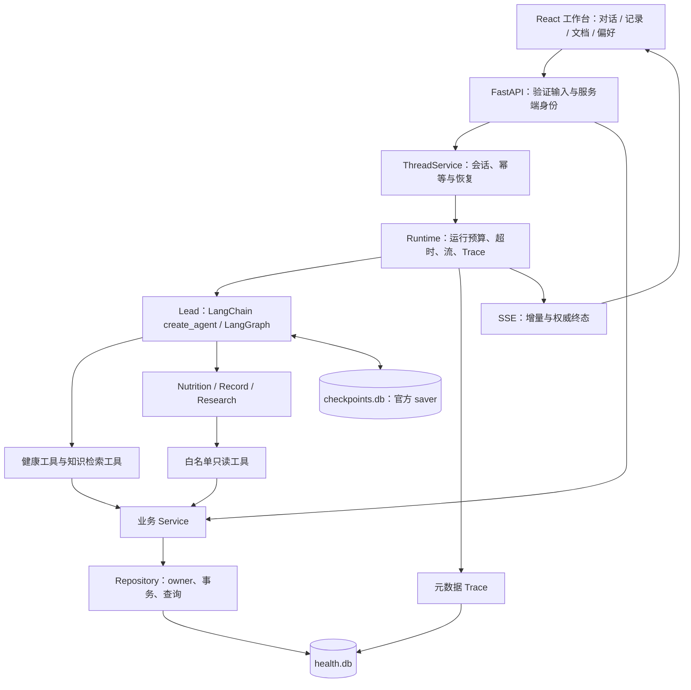

# HealthAgent 项目源码说明

- 对应目录：`HealthAgent/`
- 核对日期：2026-10-11
- 阅读对象：需要理解现有实现、定位修改位置及排查运行问题的开发者。
- 项目状态：工程落地到 Phase 12，包含独立 Benchmark 和离线优化闭环；真实 provider 当前连接失败，在线验收未完成。历史阶段文档中的“尚未实现”应结合其日期阅读。

## 如何使用这套说明

本目录镜像项目的**实际结构**。每个源码文件都有一份同名说明，保留原扩展名再加 `.md`；每个目录的 `README.md` 解释职责与上下游。例如：

| 实际项目对象 | 对应说明 |
| --- | --- |
| `backend/app/main.py` | [main.py.md](backend/app/main.py.md) |
| `backend/app/agent/` | [agent/README.md](backend/app/agent/README.md) |
| `frontend/src/App.tsx` | [App.tsx.md](frontend/src/App.tsx.md) |
| 项目原有 `README.md` | [README.md.md](README.md.md) |
| 本地 `.env` | [.env.md](.env.md)，仅解释公开配置契约，不读取或抄录实际凭据 |

完整逐文件入口见 [文件索引](文件索引.md)。本套说明覆盖手写代码、测试、配置、锁文件、开发约定、阶段文档及 `benchmark/`；不镜像依赖目录、构建产物、测试缓存、runs试跑、截图或私人数据库。首次2026-10-04交付仅添加说明；2026-10-11随Phase 11/12实现同步源码说明，保留最初快照并建立新的阶段快照。

## 系统在做什么

HealthAgent 是独立的健康信息辅助工作台。用户可录入健康指标、饮食、运动，上传私人文档，管理明确偏好，并通过持久会话和 Agent 使用这些信息。DeerFlow 提供架构与交互设计参考，运行时没有依赖它的后端或前端。

当前有两条业务入口：自然语言对话经 Lead Agent 决定调用工具；表单录入直接经 HTTP API 调用同一业务服务。默认 fake 模型是明确标记的回显演示，数据库、文档索引和页面依然真实运行。真实模型的规划与健康回答质量没有由这些工程测试证明。

## 总体调用关系

不是每次对话都会调用工具、检索或委派。专业 Agent 只有只读工具，不继承完整父会话，也没有递归委派；简单记录任务可由 Lead 直接执行。

## 五条建议阅读路线

1. **启动与装配**：[main.py](backend/app/main.py.md) → [config.py](backend/app/config.py.md) → [auth.py](backend/app/auth.py.md) → [模型适配](backend/app/models/README.md) → [Lead 装配](backend/app/agents/lead_agent.py.md)。
2. **一次对话**：[Chat 页面](frontend/src/components/Chat.tsx.md) → [浏览器 API/SSE](frontend/src/lib/api.ts.md) → [对话路由](backend/app/api/chat.py.md) / [流路由](backend/app/api/stream.py.md) → [会话服务](backend/app/services/threads.py.md) → [Runtime](backend/app/agent/runtime.py.md)。
3. **一条健康记录**：[Records 页面](frontend/src/components/Records.tsx.md) → [记录 API](backend/app/api/records.py.md) 或 [Agent 工具](backend/app/tools/health.py.md) → [领域校验](backend/app/domain/schemas.py.md) → [HealthService](backend/app/services/health.py.md) → [健康 Repository](backend/app/persistence/health_repository.py.md)。
4. **一份资料和一条偏好**：[KnowledgeService](backend/app/services/knowledge.py.md) → [RAG](backend/app/rag/README.md)；[Memory 提取](backend/app/memory/extraction.py.md) → [MemoryService](backend/app/services/memory.py.md) → [注入中间件](backend/app/memory/middleware.py.md)。
5. **失败排查**：[错误分类](backend/app/agent/errors.py.md) → [可靠性机制](backend/app/agent/reliability.py.md) → [TraceRecorder](backend/app/observability/recorder.py.md) → [Trace 存储](backend/app/persistence/trace_repository.py.md) → [测试目录](backend/tests/README.md)。
6. **评测与优化**：[Benchmark目录](benchmark/README.md) → [案例](benchmark/cases/health-v1.json.md) → [Runner](benchmark/runner.py.md) → [独立判分](benchmark/graders/task.py.md) → [统计与对比](benchmark/report.py.md) → [实际结果](benchmark/results/README.md)。

## 理解数据与状态边界

| 状态 | 保存位置 | 主要用途 |
| --- | --- | --- |
| 健康事实、文档片段与向量 | `health.db`，SQLAlchemy 模型 | 可查询业务事实及引用证据 |
| 长期偏好 | 同库独立偏好表与回执表 | 明确枚举偏好，不能代替病史或测量 |
| Thread 与请求回执 | 同库会话表与运行表 | owner、请求幂等、恢复资格、已完成答案 |
| 图消息、工具消息和待执行节点 | `checkpoints.db`，官方 AsyncSqliteSaver | 多轮对话和失败节点恢复 |
| 执行 Trace | `health.db/execution_traces` | 脱敏事件与可观察计数；不保存健康原文 |
| 浏览器临时状态 | 当前页面内存 | 凭据、增量文本、加载/错误与停止操作 |

`thread_id` 标识会话；`request_id` 标识逻辑请求并参与操作幂等；`run_id`、`trace_id` 标识一次实际尝试。恢复和已完成结果回放会产生新的运行/Trace，同时保持原请求身份。三个层面的写入——业务事务、checkpoint、Trace——没有被包装成一个跨库原子事务，故异常时需要原请求恢复和状态核对。

## 当前实现的关键边界

- 单 worker：Thread 准入、共享预算及部分容量锁是进程内机制。
- local 身份为服务端固定用户；token 模式映射凭据到 owner。客户端不能提交 user_id 改变授权。
- local_hash 为确定性词面向量基线，零词法交集门控拦截纯哈希碰撞；仍可能出现共享少量词的无关召回。向量直接保存在 SQLite，不是独立 ANN 向量服务。
- PDF 只提取可读取的文本，没有 OCR；索引成功状态与片段原子发布。
- SSE 的 `run.completed.answer` 才是最终答案，网络 EOF 和 HTTP 200 均不足以判断成功。
- Trace 缺失 token 或 SDK 内部重试不可见时保留未知；开始/结束回调不配对时capture_complete=false，completed不代表医学结论正确。
- Phase 11的29例Benchmark和Phase 12离线闭环已落地；contract工具决策为脚本规定，不能外推真实模型质量，完整技能系统仍是目标设计。

## 文档维护与校验

[校验说明](_meta/README.md) 解释覆盖范围、源码快照和链接校验。该检查验证文档完整性及源码未变，不执行应用测试、不验证医学质量，也不读取实际 `.env` 内容。以后修改代码时，应同步更新对应文件说明及受影响目录说明，再重新建立经过审查的基线。
